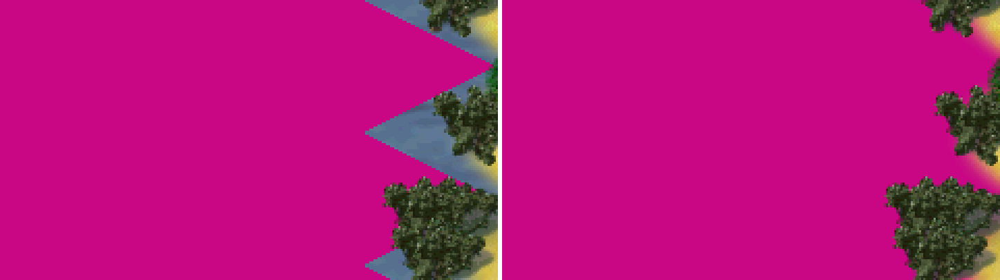
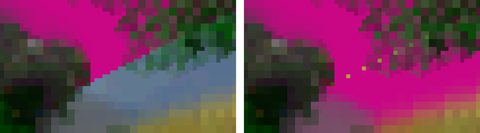

> **IMPORTANT: start the game with `SIMUTRANS_XR32=1`, or you will not see any 32-bit art.**
>
> Windows (cmd): `set SIMUTRANS_XR32=1`, then `simutrans-rgba32.exe` ·
> Windows (PowerShell): `$env:SIMUTRANS_XR32="1"`, then `.\simutrans-rgba32.exe` ·
> Linux: `SIMUTRANS_XR32=1 ./simutrans-rgba32`
>
> Without it, paks with 32-bit data still load and play, but the game draws their old 16-bit images.
> makeobj has its own switch: `STLAB_XR32_WRITE=1` writes the 32-bit data into the paks it builds.

**Published 2026-11-02. Experimental test build.** It is not an official Simutrans release, it is not merged into
Simutrans, and it is not a stable version. Use a separate folder and copies of your savegames. Nothing is promised about loading savegames or paks
made with this build in later test builds.

> **Warning, from the official trunk r12377 itself:** founding a city whose first road runs onto a road with a
> **private-way sign** crashes the game. This happens in both programs of this release, as in testing-1 to testing-3.
> Avoid private-way signs next to places where a city may be founded. See *Known issues*.

## What this build is

- **The same Simutrans SVN trunk as testing-1 to testing-3, r12377** (the game shows "125.0.2 Nightly").
- **testing-3 plus one graphics change of the XR32 32-bit renderer: the water of sloped coasts now uses the pakset's
  32-bit sea** (open problem A4 of the earlier builds). Nothing else changes: the screen update of testing-3, the
  DAY + optional NIGHT image prototype, the pak syntax and makeobj are unchanged.
- **The 16-bit renderer is unchanged.** `simutrans-16bit`, makeobj and the test kit are testing-3's files, byte for
  byte.

Each package has two programs: `simutrans-rgba32` (32-bit, XR32) and `simutrans-16bit` (the normal renderer, for
comparison).

## What's new since testing-3

The water of a **sloped** coast is not a picture in the pakset: the game makes one per slope and water animation step
when it starts, from the sea picture. Until testing-3 it made it only from the old 16-bit sea picture, so a pak whose
sea has 32-bit data showed a strip of 16-bit water on every sloped coast, next to the 32-bit sea.

testing-4 makes that water from the 32-bit sea, by day and at night, at every zoom level:

*testing-3 (left) and testing-4 (right), 1:1, pak128.german with a test sea painted in one magenta colour, so that
every 32-bit pixel shows. In testing-3 the sloped coasts keep a blue-grey strip of 16-bit water. With real 32-bit water
art the difference is subtler: the coast water gets the sea's 32-bit shades instead of the 16-bit ones.*

- **Only with 32-bit water.** With a pak whose sea has no 32-bit data, the coast water is **exactly** testing-3's:
  every coast tile was compared pixel for pixel, at four zoom levels and two light levels.
- **The same picture the game would make, in 32 bits.** The coast water is made with exactly the steps of the 16-bit
  version, from the 32-bit sea. An independent re-implementation of those steps predicted every coast tile of three
  different water paks, at 1:1 by day, with no difference.
- **Night.** Every coast pixel that comes from the sea is drawn exactly like that sea pixel at every light level,
  including paks with real night pictures.
- **Cost.** The coast water is made again only when the light level changes, a new animation step comes into view,
  the view scrolls to new coast, or the zoom changes. It is never stored as full pictures: they would take 80–160 MB.
  The steps that do not depend on the slope are shared between slopes, which makes this 4–5 times cheaper than a
  first, unreleased version of this change.

## Cost and benefit

### Frame time

Frame time is the CPU time of a frame before the frame cap, not a frame rate. The figures are testing-3 → testing-4 on
a map with many sloped coasts and 32-bit water: the median of the differences paired by repetition. 600 frames per
run, with testing-3 and testing-4 interleaved.

| Where | Typical frame (P50) | Slowest 1 % of frames (P99) |
| --- | --- | --- |
| Windows 11, 1920×1080, SDL2 / SDL3, n = 5 | no measurable difference | +0.0 to +0.75 ms (largest: light-level changes) |
| Windows 11, 2560×1440, SDL2 / SDL3, n = 5 | no measurable difference | −0.1 to +0.63 ms; zooming on SDL3 +2.45 ms (on frames that already take about 42 ms) |
| Linux WSLg X11, 1920×1080, SDL2 / SDL3, n = 3 | no measurable difference | +0.2 to +0.8 ms |

The P99 cost sits on the frames that remake coast water: light changes, scrolling to new coast, zoom changes.

### Memory and stability

- **Peak memory:** +0.6 MB (SDL2) and +0.9 MB (SDL3) with 32-bit water; no measurable difference without it.
- **Shutdown:** every run exited cleanly.
- **Sanitizers and compiler warnings:** no new report.

### Without 32-bit water

The new code does nothing.

## Checked

- **Screen updates.** A test reads back, frame by frame, what reached the window and compares it with what the game
  drew. It ran over coast scenes (still, zooming, dusk and night, scrolling, resizing, fullscreen) on:
  - Windows: SDL2 and SDL3;
  - Linux: SDL2 and SDL3, WSLg X11 and Wayland, and SDL's dummy driver.

  Every checked frame matched. The exception is the window-size switch frames under SDL3 + X11, which cannot be
  checked and behave identically in testing-3. A build made to fail on purpose was caught.
- **Earlier results.** Every result testing-3 certified was measured again with the same tests and gave the same
  values, including the automated tests (309 / 309). The one expected change is the counts of 32-bit images, which now
  include the coast water tiles.
- **Build identity.** The 16-bit program is byte-identical to testing-3's.

## How to test

1. Unpack into a new, empty folder and add a pakset. No pakset is included.
2. Start `simutrans-rgba32` with `SIMUTRANS_XR32=1`, as shown above.
3. To see the change you need a pak whose **water** has 32-bit data, built with this release's makeobj and
   `STLAB_XR32_WRITE=1` from 32-bit water art. The test kit has no such water.
4. Look at sloped coasts by day, at dusk and at night, at every zoom level, while scrolling and while the water
   animates: the coast strip should match the sea next to it. Compare with `simutrans-16bit`.
5. Without 32-bit water nothing should look different from testing-3.

## makeobj

Unchanged since testing-1. Use the makeobj of this release (`makeobj-xr32-night-prototype-r12377-testing-2-*`, the
same files as in testing-2 and testing-3) to build test content.

## Known issues

New in testing-4, accepted for this test build:

- **At zoom 2/1 a few single sand-coloured pixels can show inside the water next to sloped coasts.** We counted about
  7 on a 1920×1080 view with 93 sloped coasts. They come from how the 32-bit coast water is magnified to 2/1 against
  the 16-bit beach outline. testing-3 has none, because its coast strip was 16-bit. No other zoom level has them, and
  the open sea and flat coasts are unchanged.

  

  *Zoom 2/1, testing-3 (left) and testing-4 (right), magnified 8 times, the same magenta test sea (the one the gaps
  were counted with): the yellow sand dots in the water on the right.*

  A separate fix is planned. Please report them only if you see them at another zoom level, somewhere other than next
  to a sloped coast, or in larger numbers.

Unchanged from testing-3:
- Other ground pictures that the game makes itself are still 16-bit: climate transitions and snow on slopes. So is the
  beach outline that the water is blended with.
- Night pictures cost memory (by design).
- The DAY/NIGHT pak syntax is a prototype (by design).
- A zoom change costs about 1 ms on its first frame.
- Three lesser open points: N2, N3, N4.

From the official trunk r12377 itself, unchanged:
- the private-way sign crash;
- after a live theme change, the compass and one toolbar element keep their old picture;
- empty scenario texts;
- the chat's public tab;
- the music volume after off/on;
- zoomable toolbar icons after a map-zoom round trip (not with `SIMUTRANS_XR32=1`);
- sanitizer misalignment reports.

## Where it was tested

- **Windows 11:** SDL2 with Direct3D 9 and SDL3 with Direct3D 11, on one 3440×1440 display.
- **Linux:** Debian 13 under WSL 2 on Windows 11, SDL2 and SDL3, in WSLg's graphical session (X11 through XWayland,
  and Wayland; OpenGL) and with SDL's dummy driver.
  - **WSLg is not a native Linux desktop.** A native X11 or Wayland desktop, HiDPI above 1, several displays and other
    GPU drivers were not tested.
  - With SDL3 on X11, the one frame on which the window changes size could not be checked, as in testing-3. Every
    other frame was.
- **Paksets:** the coast checks used pak128.german with three different 32-bit water paks; pak64's coast water was
  checked at two zoom levels.
- **Not tested at all:** macOS, Android, ARM, MSVC builds.

Platforms: x86_64 only. Windows 8 or newer, and Linux with glibc 2.38 or newer; both with SDL2 or SDL3.

Details: `docs/KNOWN-ISSUES-r12377-testing-4.md`, and the certification reports in `reports/xr32-a4/` in the repository.

## Feedback

Please report problems at <https://github.com/Dkijas/simutrans-true32-renderer/issues> and include:

- this release's tag;
- your OS and package (Windows or Linux, SDL2 or SDL3);
- the pakset, and whether `SIMUTRANS_XR32=1` was set;
- a PNG screenshot.
