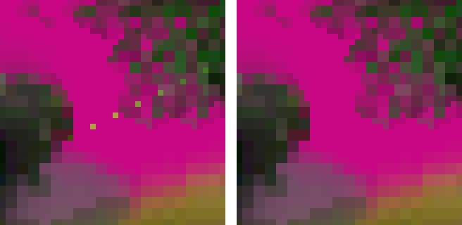

> **IMPORTANT: start the game with `SIMUTRANS_XR32=1`, or you will not see any 32-bit art.**
>
> Windows (cmd): `set SIMUTRANS_XR32=1`, then `simutrans-rgba32.exe` ·
> Windows (PowerShell): `$env:SIMUTRANS_XR32="1"`, then `.\simutrans-rgba32.exe` ·
> Linux: `SIMUTRANS_XR32=1 ./simutrans-rgba32`
>
> Without it, paks with 32-bit data still load and play, but the game draws their old 16-bit images.
> makeobj has its own switch: `STLAB_XR32_WRITE=1` writes the 32-bit data into the paks it builds.

**Published 2026-11-03. Experimental test build.** It is not an official Simutrans release, it is not merged into
Simutrans, and it is not a stable version. Use a separate folder and copies of your savegames. Nothing is promised
about loading savegames or paks made with this build in later test builds.

> **Linux builds — Experimental / Not certified**
>
> The Linux x86_64 SDL2 and SDL3 builds are provided for community testing. They are built from the XR32 testing-5
> source but have not undergone the full Linux graphics certification process.
>
> Windows x64 SDL2 and SDL3 have been certified with limitations.
>
> Please use a separate installation, back up your savegames and report any issues.

> **Warning, from the official trunk r12377 itself:** founding a city whose first road runs onto a road with a
> **private-way sign** crashes the game. This happens in both programs of this release, as in testing-1 to testing-4.
> Avoid private-way signs next to places where a city may be founded. See *Known issues*.

## What this build is

- **The same Simutrans SVN trunk as testing-1 to testing-4, r12377** (the game shows "125.0.2 Nightly").
- **testing-4 plus two fixes of the XR32 32-bit renderer and makeobj**: translucent company colours, and the zoom
  2/1 coast pixels (known issue A11 of testing-4). No new graphics features; the XR32 format and the pak syntax are
  unchanged.
- **The 16-bit renderer is unchanged.** `simutrans-16bit` and the test kit are the same files as in testing-4.
  **makeobj is new** (it carries the company-colour fix).

Each package has two programs: `simutrans-rgba32` (32-bit, XR32) and `simutrans-16bit` (the normal renderer, for
comparison).

## What's new since testing-4

### 1. Translucent company colours keep their company colour

Semi-transparent pixels painted in a **special colour** (company colours, lights) lost their meaning in testing-4: a
translucent company-colour pixel was stored as an ordinary colour, so glass showed the authoring key colour for every
company, and translucent lights stayed dark at night. testing-5 keeps their meaning, in makeobj and in the renderer:

- translucent company-colour glass shows **each company's colour**, by day and at night, with its full 8-bit alpha;
- **translucent lights glow at night** again;
- **ordinary RGB paint is never recoloured**;
- when zooming, each sample is weighted by its alpha, so glass against an opaque frame keeps the right share of colour.

**Existing paks draw exactly as in testing-4.** A pak shows the fix once it is rebuilt with **this release's makeobj**
and `STLAB_XR32_WRITE=1`. A rebuilt pak still loads in testing-4 and is right there at 1:1; zoomed, testing-4 uses its
older weighting.

### 2. No more sand pixels in the water at zoom 2/1 (A11)

At the closest zoom (2/1), testing-4 showed single sand-coloured pixels inside the water next to sloped coasts: 7 on a
1920×1080 view of a test map with 93 sloped coasts. The 32-bit coast water was magnified pixel by pixel, while the
16-bit beach outline it is blended with is magnified with the classic rounded outline. In testing-5 the 32-bit coast
water gets the same classic 2/1 outline. Its colours are unchanged, and the coast cache of testing-4 (A4) is unchanged.

*Zoom 2/1, testing-4 (left) and testing-5 (right), magnified 8 times, pak128.german with a test sea painted in one
magenta colour (the scene the gaps were counted in).*

Nothing else changes: other zoom levels, the open sea, flat coasts and every other picture draw exactly as in
testing-4.

## Cost

Measured on Windows (testing-5 against testing-4, the same lab code, interleaved runs, n = 5 at 1920×1080 and n = 3
at 2560×1440):

- **Frame time:** no measurable difference in 64 of 66 comparisons (P50, P95 and P99, coast scenes, zoom including
  2/1, dusk and night, scrolling, a city world). The other two point in opposite directions (−1.2 ms and +0.4 ms on
  the slowest 1 % at 2560×1440, n = 3), in a scene neither fix runs in: noise.
- **Memory:** peak memory not measurably different (one cell 0.2 MB lower). Clean shutdown 48 / 48.

## Checked (Windows x64, SDL2 and SDL3)

- **A11:** 0 gaps at every zoom and after repeated zoom changes; the coast water's outline at 2/1 equals the classic
  16-bit outline exactly (checked against an independent model); every other picture and zoom byte-identical to
  testing-4.
- **Company colours:** a real station with translucent company-colour glass recolours per company exactly as
  certified for the fix; a test pak with every alpha from 0 to 255 matches its model at 1:1, 9/8, 2/1, 3/4 and 1/2;
  night darkening applies once.
- **Screen updates:** a test reads back, frame by frame, what reached the window and compares it with what the game
  drew: coast scenes, zoom down to 2/1, night, and the twelve screen-update scenarios. Every checked frame matched; a
  build made to fail on purpose was caught.
- **Earlier results:** the regression battery of testing-4 gives the same results, including the automated tests
  (309 / 309); compiler warnings are the same.
- **Sanitizer:** AddressSanitizer (MSVC, **SDL2 build only**): no reports.
- **Antivirus:** Microsoft Defender (definitions 1.463.102.0): the testing-5 Windows executables were scanned clean.
- **Build identity:** the 16-bit program is unchanged; the same build recipe reproduces testing-4's published
  executables byte for byte.

**Linux: not certified.** The Linux packages were built with the same recipe and checked only for basics (see
*Where it was tested*).

## How to test

1. Unpack into a new, empty folder and add a pakset. No pakset is included.
2. Start `simutrans-rgba32` with `SIMUTRANS_XR32=1`, as shown above.
3. Company colours: rebuild a pak that uses translucent company colours with this release's makeobj and
   `STLAB_XR32_WRITE=1`; compare two companies, by day and at night, at every zoom.
4. Coasts: with a pak whose water has 32-bit data, look at sloped coasts at zoom 2/1.
5. Without such paks nothing should look different from testing-4. Compare with `simutrans-16bit`.

## makeobj

**New in testing-5:** `makeobj-xr32-night-prototype-r12377-testing-5-*`. It writes the company-colour meaning of
translucent special-colour pixels into the XR32 data (the format is unchanged). Use it to build test content.

## Known issues

- **Zoom colour residual:** when a company-colour key and ordinary *translucent* pixels fall into the same zoom
  sample, the colour can differ from an ideal mix by a few levels (up to about 6 with an opaque key, as in testing-4).
- **A12:** other ground pictures that the game makes itself (climate transitions, snow on slopes) and the beach
  outline are still 16-bit.
- **The XR32 format is experimental**, and so is the DAY/NIGHT pak syntax.
- **Night pictures cost memory**: a second full-size 32-bit picture per object that has one (by design).
- **The 16-bit renderer darkens translucent company colours twice at night**, its own behaviour, left unchanged; XR32
  darkens them once.
- Three lesser open points: **N2, N3, N4**.
- **Microsoft Defender and testing-4:** after testing-4 was published, Defender's machine-learning detection
  (`Trojan:Win32/Bearfoos.A!ml`, definitions 1.463.101.0) flagged testing-4's **Windows SDL3** `simutrans-rgba32.exe`.
  With definitions 1.463.102.0 the same file is no longer detected; it is rebuilt byte for byte from its public source
  by the same recipe. All testing-5 files were scanned clean with 1.463.102.0. See `docs/KNOWN-ISSUES-r12377-testing-5.md`, D1.

From the official trunk r12377 itself, not caused by XR32, unchanged:
- the private-way sign crash;
- after a live theme change, the compass and one toolbar element keep their old picture;
- empty scenario texts;
- the chat's public tab;
- the music volume after off/on;
- zoomable toolbar icons after a map-zoom round trip (not with `SIMUTRANS_XR32=1`);
- sanitizer misalignment reports.

## Where it was tested

- **Windows 11 x64 — certified with limitations:** SDL2 (Direct3D 9) and SDL3 (Direct3D 11), one 3440×1440 display.
  Limitations: AddressSanitizer ran on the SDL2 build only; the zoom colour residual above; Windows only.
- **Linux x86_64 — experimental, NOT certified:** built on Debian 13 (GCC 14.2) with the release recipe. Checked only:
  that it builds from the testing-5 source, the architecture and dynamic libraries, and a short start, play and clean
  exit with a 32-bit pak (Debian 13.5 under WSL 2 on Windows 11: SDL's dummy driver and one WSLg X11 window; WSLg is not a native Linux desktop). No Linux graphics certification was done for testing-5.
- **Not tested at all:** macOS, Android, ARM, a native Linux desktop, several displays.

Platforms: x86_64 only. Windows 8 or newer; Linux with glibc 2.38 or newer; both with SDL2 or SDL3.

Details: `docs/KNOWN-ISSUES-r12377-testing-5.md`, and the certification reports in `reports/xr32-testing-5/` in the
repository.

## Feedback

Please report problems at <https://github.com/Dkijas/simutrans-true32-renderer/issues> and include:

- this release's tag;
- your OS and package (Windows or Linux, SDL2 or SDL3);
- the pakset, and whether `SIMUTRANS_XR32=1` was set;
- a PNG screenshot.
